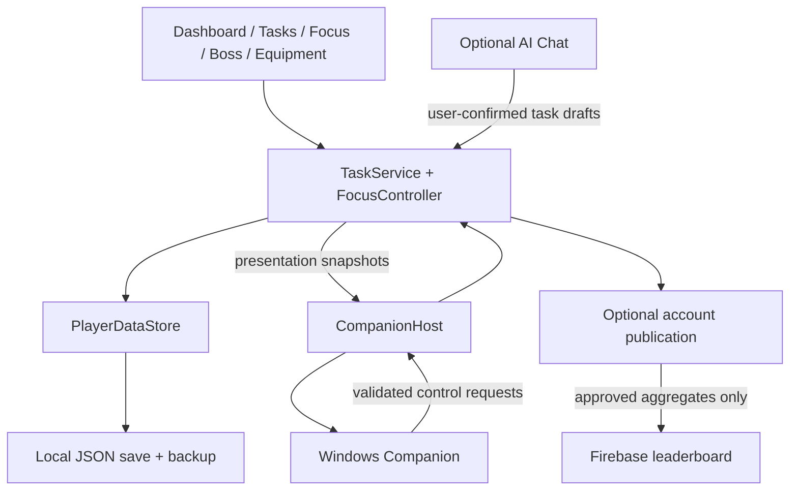

# Cat Quest

[English](README.md) | [简体中文](README.zh-CN.md)

**Turn everyday tasks and focused work into progress for your cat.**

Cat Quest is a Windows desktop productivity application built with Unity and C# as a final-year project. It combines task management and Focus timers with a cat companion, experience, equipment and deterministic boss battles. The aim is to make steady effort visible and rewarding while keeping everyday planning straightforward.

Tasks and progress are saved locally. You can create and complete tasks without an account, AI connection or network access. Optional ChatGPT assistance helps you plan. An optional Google/Firebase connection lets you share selected statistics on a leaderboard.

> **Release:** [Download Cat Quest v1.1 for Windows x64](https://github.com/KJiShou/Cat-Quest/releases/tag/v1.1). Extract the entire ZIP and run `CatQuest/CatQuest.exe`, keeping all accompanying files together. This student project remains under active development. This repository contains the Unity source project and is not distributed under an open-source license.


## Contents

- [Why Cat Quest?](#why-cat-quest)
- [Features](#features)
- [Screenshots](#screenshots)
- [Your first session](#your-first-session)
- [Progression and rewards](#progression-and-rewards)
- [Run the Unity project](#run-the-unity-project)
- [Build for Windows](#build-for-windows)
- [Optional online features](#optional-online-features)
- [Architecture](#architecture)
- [Data and privacy](#data-and-privacy)
- [Verification](#verification)
- [Troubleshooting](#troubleshooting)
- [Project documentation](#project-documentation)
- [Contributing and support](#contributing-and-support)
- [Credits and rights](#credits-and-rights)

## Why Cat Quest?

A task list records what needs to be done, but it does not always make small, repeated effort feel meaningful. Cat Quest connects real work to a visible progression loop:

**Plan a task → complete it or spend time focusing → earn progress → strengthen your cat → challenge bosses.**

The intended audience is students and desktop users who want task organization and a little game-like encouragement in the same application. Gameplay is an optional motivation layer: you do not need to win a battle or connect an AI service to maintain your task list. The project explores this design. It does not claim a measured improvement in productivity.

## Features

| Area | What you can do |
| --- | --- |
| **Dashboard** | See your cat, level, task overview, daily rewards, Focus shortcut and ranking preview. Choose which cards appear in Settings. |
| **Task management** | Create one-off Todo items and recurring Daily Tasks. Add descriptions, subtasks, dates, tags and manual difficulty. Search, filter, edit, complete and review history. |
| **Focus** | Choose Pomodoro, count-up or countdown timing. Track Focus statistics and use explicit End Early, Cancel and save-retry actions. |
| **Desktop Companion** | Open the Windows Pet Widget as a separate companion window while the main app owns the active Focus session. |
| **Cat and equipment** | Earn EXP and Fish Coins, level up, inspect stats, equip three slots, upgrade owned items and use Auto Select. |
| **Boss progression** | Challenge Cyclope, Orc and Demon. Collect mastery equipment and unlock the repeating Master Stage sequence. |
| **AI Chat — optional** | Ask questions about tasks and review proposed new tasks or edits before saving them. Difficulty remains your choice. |
| **Leaderboard — optional** | Browse Boss Stage, Tasks Completed, Focus Minutes and Power rankings after account setup and sign-in. Publishing your own statistics requires a separate opt-in. |
| **Settings and onboarding** | Adjust sound/music, Focus notifications, Dashboard visibility and tags. Use the introduction and in-app tutorial/help. |

### Task behavior

**Today** brings together today's work and overdue scheduled Todo items. **Daily Tasks** tracks recurring tasks, **Todo** groups unfinished one-off and daily tasks by date, **Tags** groups active tasks, and **History** preserves completion records.

Daily occurrences reset at local midnight. Unfinished occurrences become Missed without rewards. An overdue Todo remains active until completed or deleted. Schedules use dates rather than time-of-day appointments. Undoing and completing the same occurrence again does not grant a second reward.

Tasks also offers **List / Calendar**. The month view shows scheduled Todo items, **No Date** items and Daily entries. Future Daily entries are read-only previews; past days show only saved records. Click a date to create or manage tasks in its drawer. List and Calendar keep separate filters. Settings selects the default List tab; the current view and browsed month are remembered within the running session. See [Task system](TASK_SYSTEM.md#calendar-view).

### Focus behavior

| Mode | Timing | After successful settlement |
| --- | --- | --- |
| Pomodoro | Focus and Rest are each configurable from 1–60 minutes. Defaults are 25/5 | Starts Rest |
| Count-up | Runs until you end it | Finishes without automatic Rest |
| Countdown | Configurable from 1–180 minutes | Finishes without automatic Rest |

Switching pages or working in another application does not stop the main timer. The current Pomodoro UI offers a confirmed **Cancel**, not an early-settlement button. Stopwatch **End Focus** and Countdown **End Focus Early** retain earned-time settlement. Underlying and historical End Early settlement remains supported and is distinct from cancellation. Cancel grants no rewards and does not start Rest. Invalid/interrupted sessions and Rest grant no EXP, Fish Coins or tickets.

If saving a completed session fails, settlement waits for **Retry Save**. Reward animations and the Companion never grant rewards independently of the main application's saved result.

## Screenshots

These are actual Unity-rendered screens using synthetic demonstration data, not design mockups or personal task records. Capture details and any historical images are identified in the [image notes](docs/images/README.md).

### Task management


### Calendar


Switch between List and Calendar to review dates, open a day, or add a task. Future Daily entries are previews; they cannot be completed early.

### Focus


### Boss battles


### Settings


### Equipment


### Optional AI Chat


## Your first session

1. Run the project and follow the introduction to name your cat.
2. Open **Tasks**, add something you actually intend to do, and choose its difficulty. Add a date, tags or subtasks if useful.
3. Complete the task when finished. Your cat earns locally calculated rewards, subject to daily limits.
4. Return to **Dashboard** to claim available daily goal rewards.
5. At **Cat Lv.2**, use Focus to work through a session. Start with the default 25-minute Pomodoro or choose another mode.
6. At **Cat Lv.5**, Boss and Leaderboard become available. Boss entry still requires a ticket. Online ranking reads require account configuration and sign-in.
7. Claim a qualifying daily reward to unlock equipment, then earn boss mastery items and spend Fish Coins on upgrades.

You can keep using tasks throughout this progression. Google sign-in and ChatGPT sign-in are separate optional connections.

## Progression and rewards

**EXP** raises Cat Level, **Fish Coins** pay for equipment upgrades, and **Boss Tickets** pay for battle entry. The UI presents current rewards and remaining allowances. The following describes the current implementation, not a permanent balance promise.

| Source | Current base rules |
| --- | --- |
| Task completion | Easy / Medium / Hard: **15 / 25 / 40 EXP** and **6 / 10 / 16 Fish Coins** at Lv.1. Daily base allowances: **150 EXP / 60 Fish Coins**. |
| First valid task settlement of the day | **1 Boss Ticket**, independent of task currency caps. Undo/recompletion cannot award it twice. |
| Valid Focus | Base **0.5 EXP per complete minute**, **1 Fish Coin per complete 5 minutes**, and **1 ticket per complete 25 minutes**. Intervals are calculated within each session. |
| Focus limits | EXP/Fish eligibility is limited to the first **180 minutes per session** and **240 minutes per day**. Focus tickets have a separate **3-per-day** limit. |
| Daily goals | Claim at **1 task**, then **3 distinct task occurrences**, and **25 accumulated eligible Focus minutes**. Goal bonuses are separate from base currency allowances. |

Task reward amounts and task currency caps scale by `1 + 0.1 × (Cat Level − 1)`, using the level before settlement. Focus currency uses the level at session start. Scaled amounts are rounded down. Task completion still counts after its currency cap is reached. Eligible End Early time contributes to the Focus goal.

### Equipment and battles

There are three equipment slots: **Weapon (ATK)**, **Armour (DEF)** and **Head Accessory (ASPD)**. Each of the three normal bosses has its own three-piece set. Equipment can be upgraded with Fish Coins, but its level cannot exceed Cat Level. Set bonuses and equipped stats feed into battle calculations.

Confirmed battle entry consumes one ticket. A valid defeat consumes that entry. A valid victory progresses. The result is calculated deterministically from the saved stats/configuration. Technical interruption uses the existing recovery path instead of inventing a victory.

- **Boss 2:** defeat Boss 1 and reach Lv.10.
- **Boss 3:** defeat Boss 2 and reach Lv.20.
- **Master Stage:** unlock with the first valid Boss 3 victory. Only victories advance the stage.
- **Normal mastery:** each boss tracks its own 5/10/15-win equipment milestones. Master Stage does not grant normal-boss mastery equipment.

See [Boss battle details](BOSS_BATTLE.md) and [equipment details](EQUIPMENT.md). The current claim code and UI determine which component is available at a milestone.

## Run the Unity project

### Requirements

| Requirement | Project configuration |
| --- | --- |
| Operating system | Windows for the full application, native Companion and credential storage |
| Unity Editor | **6000.3.10f1**, as recorded in [ProjectVersion.txt](ProjectSettings/ProjectVersion.txt) |
| Unity Hub modules | Windows Build Support for the backend selected in your build profile |
| Source tools | Git. A C# editor is useful for development |
| Network | Needed for initial dependency import and optional online features, not ordinary local task use |

The project uses Unity UI/TextMesh Pro, URP and Unity 2D packages. Exact declared package versions are in [Packages/manifest.json](Packages/manifest.json), with resolved dependencies in [Packages/packages-lock.json](Packages/packages-lock.json). Do not upgrade the Editor or packages just to open the project.

Third-party art, UI, fonts and runtime components retain their own terms. Repository visibility does not grant a license to reuse those assets. See [third-party notices](THIRD_PARTY_NOTICES.md).

### Open and play

```powershell
git clone https://github.com/KJiShou/Cat-Quest.git
```

1. In **Unity Hub**, add the cloned folder containing `Assets`, `Packages` and `ProjectSettings`.
2. Open it with **Unity 6000.3.10f1**. Allow package resolution, asset import and script compilation to finish.
3. Open [`Assets/Scenes/CatQuestBootstrap.unity`](Assets/Scenes/CatQuestBootstrap.unity) and enter Play Mode for the startup route.
4. For direct UI development, [`Assets/Scenes/CharacterHome.unity`](Assets/Scenes/CharacterHome.unity) contains the main application. It bypasses the normal startup route. Use Bootstrap when reviewing onboarding.
5. Resolve Console errors before testing. A missing account configuration disables online sign-in, not local tasks.

Normal Editor Play Mode uses the application's normal local save unless an existing verifier redirects it. Use an isolated verification flow for experiments. Do not delete your player data to recreate a new-user screenshot.

## Build for Windows

1. Open the project and wait for compilation/import to complete.
2. Open **File → Build Profiles** and select the Windows platform/profile, installing required build support through Unity Hub if necessary.
3. Preserve the enabled scene order in [EditorBuildSettings.asset](ProjectSettings/EditorBuildSettings.asset): **CatQuestBootstrap → IntroStory → CharacterHome**. Bootstrap must start the built app.
4. Build to an ignored output folder such as `Builds/Windows/CatQuest.exe`. Keep the executable together with its generated data folder and runtime files.
5. Launch the executable and review the startup flow. Use a Development Build when collecting diagnostics.

The Pet Widget starts a separate instance of the Windows player in Companion mode. When launched from the Editor, `CompanionHost` looks for **`Builds/Windows/CatQuest.exe`**. A Game View screenshot alone does not demonstrate native window behavior. Test the built application for close/minimize/resize and Companion lifecycle behavior.

## Optional online features

### AI Chat

Open Chat or **Settings → AI** to connect through the system browser. The implementation uses ChatGPT browser authorization and the connected account's available models/usage. Availability depends on successful authorization and account/service access. This repository does not supply a working account or guarantee access.

Chat may request relevant task information and propose new tasks or edits. You review and confirm every proposal locally. It cannot complete or delete tasks, set rewards or silently change difficulty. Disconnecting or losing network access leaves manual task management available.

See [AI implementation and verification](AI_IMPLEMENTATION.md) for the actual connection/storage behavior and isolated test procedures. Do not paste account credentials into source files or issue reports.

### Google account and leaderboard

The online leaderboard requires your own Google/Firebase configuration. It uses browser Google sign-in, Firebase Authentication REST and Firestore REST. No Firebase Unity SDK is required by this implementation.

Follow [Firebase setup](Firebase/SETUP.md). The local `Assets/Resources/AccountConnectionConfig.asset` is ignored by Git. An [example configuration](Firebase/AccountConnectionConfig.asset.example) is supplied. Configuration and cloud deployment are explicit setup steps, not something opening Unity performs.

Sign-in alone does not publish your progress. Sharing requires opt-in. Rankings use published aggregates and are not cloud saves, multiplayer combat or a cheat-resistant competitive backend.

## Architecture

The main Unity process owns task state, timing, settlement and persistence. UI components display committed state and forward input to the existing services.



| Path | Responsibility |
| --- | --- |
| [`Assets/Scripts/Tasks`](Assets/Scripts/Tasks) | TaskService partials, rewards, Focus controller/statistics and local storage |
| [`Assets/Scripts/Battle`](Assets/Scripts/Battle) | Deterministic battle rules and battle presentation helpers |
| [`Assets/Scripts/Equipment`](Assets/Scripts/Equipment) | Equipment definitions, stats and character aura presentation |
| [`Assets/Scripts/UI`](Assets/Scripts/UI) | Page presenters, navigation, shared feedback, tutorial and Companion |
| [`Assets/Scripts/AI`](Assets/Scripts/AI) | Chat, proposal review, authorization and protected local AI storage |
| [`Assets/Scripts/Account`](Assets/Scripts/Account) / [`Leaderboard`](Assets/Scripts/Leaderboard) | Optional account publication and ranking reads |
| [`Assets/Scripts/Settings`](Assets/Scripts/Settings) | Settings, sound and Windows Focus notifications |
| [`Assets/Prefabs`](Assets/Prefabs) / [`Assets/Scenes`](Assets/Scenes) | Editable authored UI and application scenes |
| [`Assets/Editor`](Assets/Editor) | Project verification and scoped Editor tools |
| [`Firebase`](Firebase) / [`Tools`](Tools) | Cloud setup/rules and supporting verification/audio tools |

`GameDataManager` owns the shared `TaskService` and `PlayerDataStore`. Mutations validate and persist before publishing successful state changes. UI animations, AI responses and Companion messages are not authoritative reward sources.

## Data and privacy

The normal save is **`Application.persistentDataPath/catquest-data.json`**. With the current company/product settings, its Windows location is:

```text
%USERPROFILE%\AppData\LocalLow\DefaultCompany\Cat Quest\catquest-data.json
```

Saving uses a temporary file, atomic replacement and a `.bak` backup. The loader can recover from a valid backup when the main save is unreadable. Back up your data before manual recovery or migration. Do not edit it while the application is running. Task/progression JSON is local storage, not an encrypted vault.

| Data | Handling |
| --- | --- |
| Tasks, schedules, subtasks, history, rewards and equipment | Saved locally. Not included in leaderboard uploads |
| AI conversation | Stored separately in `ai/chat.dpapi`, protected with Windows current-user DPAPI. Sent messages and requested task facts are sent to the connected AI service |
| AI connection | Protected local connection records. Separate from the player-save JSON |
| Google/Firebase credentials | Windows Credential Manager for refresh credentials. Access tokens remain in memory |
| Opt-in leaderboard record | Only `playerId`, `playerName`, `bossStage`, `totalTasksCompleted`, `totalFocusMinutes`, `power`, `catLevel` and server `updatedAt` |

Turning sharing off stops new uploads and requests removal. Offline removal can remain pending until connectivity and the linked account are available. Signing out does not erase local progress. Publishing aggregates does not back up your tasks or support restoring a save on another computer.

## Verification

The repository has custom Unity Editor verifiers and Windows smoke scripts. These are available checks, **not a claim that every flow passes on every revision**. Historical reports/screenshots are not current test results.

Read [AGENTS.md](AGENTS.md) before changing code/assets. Run one flow at a time in the already-open Editor, use isolated saves, and keep results in ignored `Temp/` or `Library/` directories.

| Check | Entry point / evidence |
| --- | --- |
| Task rules | **Tools → Cat Quest → Verify Task System**. `Temp/task-system.verification` |
| Rewards and Focus | **Tools → Cat Quest → Verify Rewards and Focus**. `Temp/reward-system.verification` |
| Equipment/battle/domain aggregate | Create `Temp/verify-equipment.request`. Result: `Temp/verify-equipment.result`. This includes the battle → Focus → reward → task chain. Do not run every child redundantly. |
| Settings and rendered UI | Create `Temp/verify-settings-play.request`. Current run path: `Library/SettingsVerification/latest-run.txt` |
| Account rules with isolated mocks | **Tools → Cat Quest → Verify Settings Account**. `Temp/verify-settings-account.result` |
| Native Windows behavior | Use the applicable scripts under `Tools` and instructions in [Settings](SETTINGS.md), [Focus/Companion](FOCUS_COMPANION.md) and [Leaderboard](LEADERBOARD.md) |

For a request-driven check, wait until the Editor is stopped and compilation has finished, then create only the requested flag from the project root:

```powershell
New-Item -ItemType Directory -Path Temp -Force | Out-Null
New-Item -ItemType File -Path Temp/verify-equipment.request -Force | Out-Null
```

The open Editor consumes the request. Check the result's modification time and contents after that run. An absent or old file is not a pass. Use the relevant visual review as well as automated checks for UI changes. A successful `dotnet build` alone does not establish Unity compatibility.

## Troubleshooting

| Symptom | Check |
| --- | --- |
| Focus, Boss or Leaderboard is locked | Current Cat Level: Focus unlocks at Lv.2. Boss/Leaderboard at Lv.5. Later bosses have additional victory/level gates. |
| Pet Widget will not open from the Editor | Build the Windows player to `Builds/Windows/CatQuest.exe`. Inspect the error shown by the app. |
| Google sign-in is unavailable | Follow the Firebase setup guide and provide the local account configuration asset. |
| Leaderboard is empty/unavailable | Check sign-in, connectivity, deployed Firestore rules/indexes and whether any players have opted in. |
| AI cannot connect or respond | Check the AI settings connection and account usage/access. Continue using manual tasks while troubleshooting. |
| A completed task awards no more currency | Daily allowances may be exhausted or that occurrence may already have been rewarded. Completion is still recorded. |
| Focus settlement shows Retry Save | Resolve the local write/storage problem and retry through the UI. Do not manually award rewards. |
| README images do not appear on GitHub | Include `docs/images` in the same pushed change as this README. The image links are relative. |

## Project documentation

| Guide | Topic |
| --- | --- |
| [Task system](TASK_SYSTEM.md) | Task UI, recurrence, persistence and reward behavior |
| [Focus and Companion](FOCUS_COMPANION.md) | Timer ownership, separate process and Windows checks |
| [Focus animation](FOCUS_ANIMATION.md) | Presentation during Focus |
| [Boss battles](BOSS_BATTLE.md) / [Equipment](EQUIPMENT.md) | Combat, progression and loadouts |
| [AI](AI_IMPLEMENTATION.md) | Chat and confirmed task proposals |
| [Leaderboard](LEADERBOARD.md) / [Firebase setup](Firebase/SETUP.md) | Optional online ranking and deployment |
| [Settings](SETTINGS.md) / [Sound](SOUND.md) | Preferences, tags, notifications and audio |
| [Tutorial](TUTORIAL_SYSTEM.md) / [Cursor](CURSOR_SYSTEM.md) | Onboarding, feature gates and cursor configuration |
| [Contributor instructions](AGENTS.md) | Asset safety, behavior contracts and required checks |
| [Complete documentation index](docs/INDEX.md) | English/Chinese pairs, historical records and maintenance conventions |
| [Complete documentation index](docs/INDEX.md) | English/Chinese pairs, historical records and maintenance conventions |
| [Complete documentation index](docs/INDEX.md) | English/Chinese pairs, historical records and maintenance conventions |

Historical verification records retain their original dates and do not establish a current pass. Current implementation and approved project rules define behavior, including earned End Early rewards and Chat replacing earlier automatic difficulty advice.

## Contributing and support

Maintained by [KJiShou](https://github.com/KJiShou). For reproducible bugs or focused feature suggestions, use [GitHub Issues](https://github.com/KJiShou/Cat-Quest/issues). Include the revision, Unity/Windows version, reproduction steps and sanitized screenshots when relevant.

Read [CONTRIBUTING.md](CONTRIBUTING.md) before proposing changes and follow the [Code of Conduct](CODE_OF_CONDUCT.md). For vulnerabilities or credential exposure, follow [SECURITY.md](SECURITY.md) instead of posting sensitive details publicly. Support is best-effort for a student project. There is no guaranteed response time.

## Credits and rights

Cat Quest uses Layer Lab's **GUI Pro–SimpleCasual** UI and **2D Characters–PetPack2**, alongside other third-party artwork, fonts, audio and runtime components. The project preserves its authored Fredoka typography and the vendor resources' individual notices. See [THIRD_PARTY_NOTICES.md](THIRD_PARTY_NOTICES.md) for source locations and bundled terms.

**Project-owned work: all rights reserved.** Public visibility is for project presentation and does not grant permission to reuse, redistribute or commercialize the work. Third-party materials remain under their respective owners' terms. See [LICENSE](LICENSE) and the [licensing explanation](docs/LICENSING.md).
