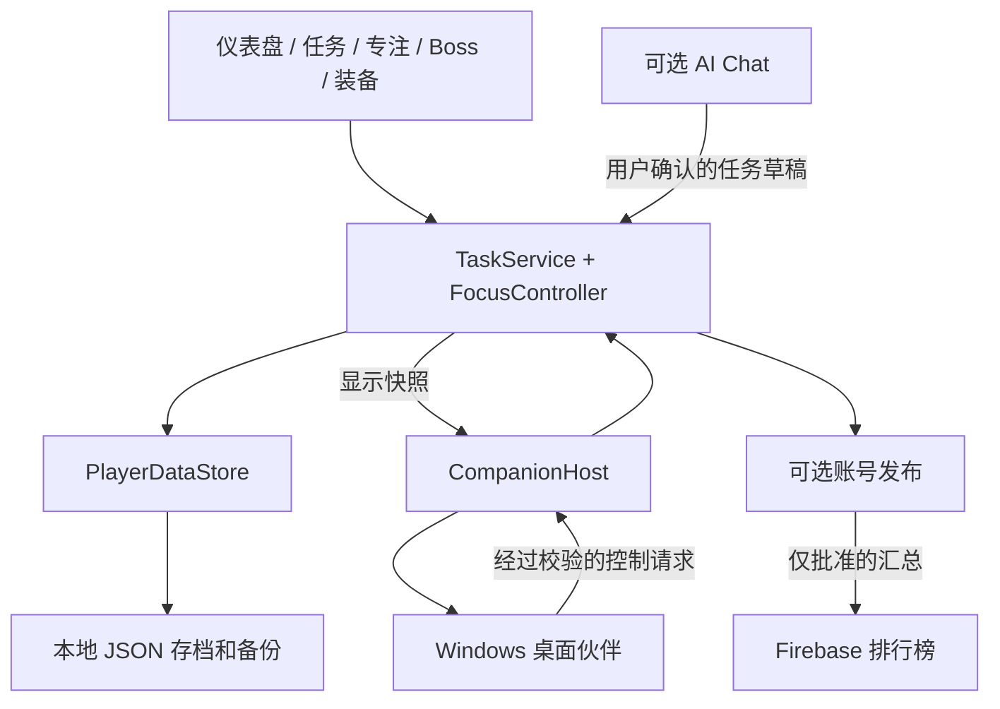

# Cat Quest

[English](README.md) | [简体中文](README.zh-CN.md)

**让每天完成的任务和投入的专注时间，成为猫咪成长的动力。**

Cat Quest 是使用 Unity 和 C# 开发的 Windows 桌面效率应用，也是一个毕业项目。它把任务管理、专注计时与猫咪伙伴、经验值、装备和确定性 Boss 战斗结合，让持续投入变得可见，同时保持日常规划简单易用。

任务和进度保存在本地。创建和完成任务不需要账号、AI 连接或网络。可选的 ChatGPT 功能帮助规划任务，可选的 Google/Firebase 连接用于在排行榜分享指定汇总统计。

> **正式版：** [下载 Cat Quest v1.1（Windows x64）](https://github.com/KJiShou/Cat-Quest/releases/tag/v1.1)。完整解压 ZIP，运行 `CatQuest/CatQuest.exe`，并保留所有附带文件。本学生项目仍在持续开发，仓库提供 Unity 源工程；本项目没有采用开源许可证。


## 目录

- [为什么做 Cat Quest](#为什么做-cat-quest)
- [功能](#功能)
- [项目截图](#项目截图)
- [第一次使用](#第一次使用)
- [成长与奖励](#成长与奖励)
- [运行 Unity 工程](#运行-unity-工程)
- [构建 Windows 版本](#构建-windows-版本)
- [可选在线功能](#可选在线功能)
- [架构](#架构)
- [数据与隐私](#数据与隐私)
- [验证](#验证)
- [常见问题](#常见问题)
- [项目文档](#项目文档)
- [贡献与支持](#贡献与支持)
- [致谢与权利](#致谢与权利)

## 为什么做 Cat Quest

任务清单能记录待办事项，却不一定能让重复的小进步产生足够反馈。Cat Quest 将实际工作连接到可见的成长循环：

**规划任务 → 完成任务或投入专注时间 → 获得成长资源 → 强化猫咪 → 挑战 Boss。**

目标用户是希望在同一应用中管理任务并获得适度游戏化鼓励的学生和桌面用户。游戏内容只是激励层，不需要战斗获胜或连接 AI 才能维护任务清单。本项目探索这种设计，不声称已经通过实验测量证明效率提升。

## 功能

| 模块 | 可以做什么 |
| --- | --- |
| **Dashboard 仪表盘** | 查看猫咪、等级、任务、每日奖励、专注入口和排行榜预览。在设置中选择显示的卡片。 |
| **任务管理** | 创建一次性 Todo 和每日重复任务，设置描述、子任务、日期、标签及手动难度，搜索、筛选、编辑、完成和查看历史。 |
| **Focus 专注** | 使用番茄钟、正计时或倒计时，查看统计，并通过明确的提前结束、取消和重试保存操作管理会话。 |
| **桌面伙伴** | 在单独的 Windows Pet Widget 窗口查看伙伴，主应用仍负责专注会话。 |
| **猫咪与装备** | 获取经验与鱼币、升级、查看属性、管理三个装备槽、升级装备及自动选择搭配。 |
| **Boss 成长** | 挑战 Cyclope、Orc、Demon，获得熟练度装备并解锁循环的 Master Stage。 |
| **AI Chat，可选** | 查询任务，审阅 AI 提议的新任务或修改，再确认保存。难度始终由用户决定。 |
| **排行榜，可选** | 完成配置并登录后查看 Boss 进度、完成任务数、专注分钟和战力排名。公开自己的统计需要另外开启参与。 |
| **设置与教学** | 调整音效、音乐、专注通知、仪表盘内容和标签，使用开场故事及应用内教学与帮助。 |

### 任务行为

**Today** 汇总今天的任务和逾期的已安排 Todo。**Daily Tasks** 管理每日重复任务，**Todo** 按日期分组展示未完成的一次性和每日任务，**Tags** 按标签分组，**History** 保留完成记录。

每日任务在本地午夜切换执行日期，未完成项标记为 Missed 且不发奖。逾期 Todo 仍保持有效，直到完成或删除。日程使用日期而非具体时刻。撤销后重新完成同一次执行记录不会重复发奖。

Tasks 还提供 **List / Calendar** 切换。月历展示已安排的 Todo、**No Date** 未安排集合与 Daily；未来 Daily 是只读预览，过去仅显示已保存记录。点击日期可在抽屉内创建和管理任务。List 与 Calendar 各自保留筛选；Settings 设置默认列表分类，当前视图和浏览月份只在本次运行中记忆。详见[任务系统](TASK_SYSTEM.zh-CN.md#日历视图)。

### 专注行为

| 模式 | 计时方式 | 成功结算后 |
| --- | --- | --- |
| Pomodoro 番茄钟 | 专注和休息各 1–60 分钟，默认 25/5 | 进入休息 |
| Stopwatch 正计时 | 持续计时直到主动结束 | 结束，不自动休息 |
| Countdown 倒计时 | 1–180 分钟 | 结束，不自动休息 |

切换页面或使用其他应用不会停止主计时器。当前番茄钟界面提供需要确认的 **Cancel**，不提供提前结算按钮。正计时的 **End Focus** 和倒计时的 **End Focus Early** 按既有规则结算有效时间。底层及历史 End Early 结算仍受支持，不能与无奖励的 Cancel 混为一谈。无效或中断会话不发奖，休息也不授予经验、鱼币或入场券。

保存失败时，结算停留在 **Retry Save**。奖励动画和桌面伙伴不能绕过主应用保存结果自行发奖。

## 项目截图

以下是使用独立演示数据在 Unity 中实际渲染的画面，不是设计稿，也不是个人任务记录。拍摄来源和限制见[图片说明](docs/images/README.zh-CN.md)。

### 任务管理


### 日历


在 List 与 Calendar 间切换，查看日期、打开当日列表或新建任务。未来 Daily 是预览，不能提前完成。

### 专注


### Boss 战斗


### 设置


### 装备


### 可选 AI Chat


## 第一次使用

1. 运行项目，跟随开场流程为猫咪命名。
2. 打开 **Tasks**，添加真正打算完成的任务，手动选择难度，按需添加日期、标签和子任务。
3. 完成实际工作后勾选任务，在每日限制内获得本地计算的奖励。
4. 返回 **Dashboard**，领取达到条件的每日目标奖励。
5. 达到 **Lv.2** 后使用 Focus，可以从默认 25 分钟番茄钟开始。
6. 达到 **Lv.5** 后解锁 Boss 和排行榜。Boss 仍需入场券，读取线上排行榜仍需配置和登录。
7. 领取符合条件的每日奖励后解锁装备，再通过 Boss 熟练度收集部件并用鱼币升级。

整个过程中都可以继续管理任务。Google 和 ChatGPT 是两套独立、可选的登录连接。

## 成长与奖励

**EXP** 提升猫咪等级，**Fish Coins** 用于升级装备，**Boss Tickets** 用于战斗入场。界面显示当前奖励和剩余额度。下表描述当前实现，不代表永久不变的平衡承诺。

| 来源 | 当前基础规则 |
| --- | --- |
| 完成任务 | Lv.1 的 Easy / Medium / Hard 分别为 **15 / 25 / 40 EXP** 与 **6 / 10 / 16 鱼币**，每日基础额度为 **150 EXP / 60 鱼币**。 |
| 当天首个有效首次结算任务 | 自动给予 **1 张 Boss Ticket**，独立于任务货币额度，撤销或重做不重复发放。 |
| 有效专注 | 每完整分钟基础 **0.5 EXP**，每完整 5 分钟 **1 鱼币**，每完整 25 分钟 **1 入场券**，区间按单次会话计算。 |
| 专注限制 | 经验和鱼币只计算每次前 **180 分钟**、每天前 **240 分钟**，专注入场券另有每日 **3 张**上限。 |
| 每日目标 | 完成 **1 个任务**后领取，再达到 **3 个不同执行记录**，以及累计 **25 分钟有效专注**。这些奖励独立于基础货币额度。 |

任务奖励及任务货币上限使用结算前等级的 `1 + 0.1 × (Cat Level − 1)` 倍率。专注货币使用会话开始等级。倍率后的数额向下取整。达到货币上限仍记录完成。有效 End Early 时间仍计入专注目标。

### 装备与战斗

三个装备槽分别是 **Weapon 武器（ATK）**、**Armour 护甲（DEF）** 和 **Head Accessory 头饰（ASPD）**。三个普通 Boss 各有独立的三件套。装备升级消耗鱼币，等级不得超过猫咪等级。套装和装备属性共同参与战斗计算。

确认入场扣除一张券。有效失败消耗该次入场，有效胜利推进进度。战斗依据保存的属性和配置确定性计算，技术中断通过既有恢复流程处理，不伪造胜利。

- **Boss 2**：击败 Boss 1 且达到 Lv.10。
- **Boss 3**：击败 Boss 2 且达到 Lv.20。
- **Master Stage**：首次有效击败 Boss 3 后解锁，仅胜利推进。
- **普通熟练度**：每个 Boss 独立计算 5/10/15 胜装备里程碑，Master Stage 不授予普通熟练度装备。

详见 [Boss 指南](BOSS_BATTLE.zh-CN.md)和[装备指南](EQUIPMENT.zh-CN.md)。具体里程碑可领取部件以当前代码与界面为准。

## 运行 Unity 工程

### 环境要求

| 要求 | 项目配置 |
| --- | --- |
| 操作系统 | 完整应用、原生桌面伙伴与凭证存储面向 Windows |
| Unity Editor | **6000.3.10f1**，见 [ProjectVersion.txt](ProjectSettings/ProjectVersion.txt) |
| Unity Hub 模块 | 与构建配置所选后端对应的 Windows Build Support |
| 开发工具 | Git，开发时建议配合 C# 编辑器 |
| 网络 | 首次依赖导入及可选在线功能需要网络，普通本地任务操作不需要 |

项目使用 Unity UI/TextMesh Pro、URP 和 Unity 2D 包。声明版本见 [manifest.json](Packages/manifest.json)，解析后的依赖见 [packages-lock.json](Packages/packages-lock.json)。不要为了打开工程而顺便升级 Editor 或包。

第三方 UI、美术、字体和运行库仍遵守各自条款。仓库公开不等于授权复用素材，见[第三方说明](THIRD_PARTY_NOTICES.zh-CN.md)。

### 打开和运行

```powershell
git clone https://github.com/KJiShou/Cat-Quest.git
```

1. 在 Unity Hub 添加包含 `Assets`、`Packages` 和 `ProjectSettings` 的克隆目录。
2. 使用 **6000.3.10f1** 打开，等待依赖解析、导入和编译结束。
3. 打开 [CatQuestBootstrap.unity](Assets/Scenes/CatQuestBootstrap.unity)，进入 Play Mode 检查正常启动流程。
4. [CharacterHome.unity](Assets/Scenes/CharacterHome.unity) 包含主应用，可用于直接开发 UI，但会绕过正常启动流程。检查教学时使用 Bootstrap。
5. 先处理 Console 错误。缺少账号配置只会禁用在线登录，不会禁用本地任务。

普通 Editor Play Mode 默认使用正常本地存档，除非验证器已将其重定向。实验请使用隔离验证流程，不要删除玩家存档来拍新用户截图。

## 构建 Windows 版本

1. 等待导入和编译完成。
2. 打开 **File → Build Profiles**，选择 Windows，通过 Unity Hub 安装必要支持。
3. 保留 [EditorBuildSettings.asset](ProjectSettings/EditorBuildSettings.asset) 的启用场景顺序：**CatQuestBootstrap → IntroStory → CharacterHome**。
4. 构建到忽略目录，例如 `Builds/Windows/CatQuest.exe`。分发时保留数据目录和其他运行库文件。
5. 启动 exe 检查流程，收集诊断时使用 Development Build。

Pet Widget 会以 Companion 模式启动另一个 Windows 进程。从 Editor 启动时，`CompanionHost` 查找 **`Builds/Windows/CatQuest.exe`**。Game View 截图不能证明原生窗口行为，关闭、最小化、缩放和生命周期必须在实际构建中检查。

## 可选在线功能

### AI Chat

从 Chat 或 **Settings → AI** 通过系统浏览器连接 ChatGPT。可用模型与额度取决于连接账号和服务权限，仓库不提供账号，也不保证服务访问。

Chat 可查询相关任务并提议创建或修改。所有建议均需本地审阅确认，不能完成、删除任务、设置奖励或暗中修改难度。断开或离线时手动任务仍然可用。

连接、存储和隔离测试见 [AI 指南](AI_IMPLEMENTATION.zh-CN.md)。不要把凭证写进源文件或问题报告。

### Google 账号与排行榜

需要自己的 Google/Firebase 配置。实现使用浏览器 OAuth、Firebase Authentication REST 和 Firestore REST，不依赖 Firebase Unity SDK。

按 [Firebase 配置指南](Firebase/SETUP.zh-CN.md)设置。本机 `Assets/Resources/AccountConnectionConfig.asset` 已被 Git 忽略，仓库提供[示例](Firebase/AccountConnectionConfig.asset.example)。打开 Unity 不会自动配置或部署云服务。

登录本身不上传进度，需要另行开启参与。排行榜只是公开汇总，不是云存档、多人战斗或防作弊竞赛后端。

## 架构

主 Unity 进程负责任务状态、计时、结算和持久化，UI 显示已经提交的状态，并将输入交给已有服务。



| 路径 | 职责 |
| --- | --- |
| [Tasks](Assets/Scripts/Tasks) | TaskService 分部类、奖励、专注控制、统计及本地存储 |
| [Battle](Assets/Scripts/Battle) | 确定性战斗规则与表现辅助 |
| [Equipment](Assets/Scripts/Equipment) | 装备定义、属性及角色光环 |
| [UI](Assets/Scripts/UI) | 页面、导航、共用反馈、教学及桌面伙伴 |
| [AI](Assets/Scripts/AI) | 聊天、提议审阅、授权及受保护存储 |
| [Account](Assets/Scripts/Account) 与 [Leaderboard](Assets/Scripts/Leaderboard) | 可选账号发布及排名读取 |
| [Settings](Assets/Scripts/Settings) | 偏好、声音和 Windows 提醒 |
| [Prefabs](Assets/Prefabs) 与 [Scenes](Assets/Scenes) | 可编辑 UI 资产及应用场景 |
| [Editor](Assets/Editor) | 项目验证与定点编辑器工具 |
| [Firebase](Firebase) 与 [Tools](Tools) | 云端设置、规则、验证脚本和音频工具 |

`GameDataManager` 持有共享服务和存储。变更先验证并持久化，再发布成功状态。动画、AI 回复和伙伴消息都不是奖励权威。

## 数据与隐私

正常存档为 **`Application.persistentDataPath/catquest-data.json`**。当前 Windows 默认路径：

```text
%USERPROFILE%\AppData\LocalLow\DefaultCompany\Cat Quest\catquest-data.json
```

保存使用临时文件、原子替换及 `.bak` 备份。主文件无法读取时可从有效备份恢复。手动恢复或迁移前应备份，应用运行时不要编辑存档。任务 JSON 是本地文件，不是加密保险库。

| 数据 | 处理方式 |
| --- | --- |
| 任务、日程、子任务、历史、奖励和装备 | 保存在本地，不包含在排行榜上传中 |
| AI 对话 | 独立存储在 Windows 当前用户 DPAPI 保护的 `ai/chat.dpapi`，已发送消息和请求查询的任务事实会发送到连接的 AI 服务 |
| AI 连接 | 独立于玩家 JSON 的受保护连接记录 |
| Google/Firebase 凭证 | 刷新凭证保存在 Windows Credential Manager，访问令牌仅在内存中 |
| 自愿参与的排名记录 | 仅 `playerId`、`playerName`、`bossStage`、`totalTasksCompleted`、`totalFocusMinutes`、`power`、`catLevel` 和服务器 `updatedAt` |

关闭分享会停止上传并请求移除，离线时可能继续显示等待移除，需要恢复连接及关联账号。退出登录不删除本地进度，发布汇总也不能恢复另一台电脑上的完整存档。

## 验证

仓库提供自定义 Unity 验证器及 Windows 冒烟脚本。它们是可用检查入口，**不代表每个版本的全部流程都已通过**。历史报告不是当前结果。

修改前阅读 [AGENTS.zh-CN.md](AGENTS.zh-CN.md)。使用已经打开的 Editor，每次只运行一个流程，使用隔离存档，将结果留在忽略的 `Temp/` 或 `Library/`。

| 检查 | 入口和证据 |
| --- | --- |
| 任务规则 | **Tools → Cat Quest → Verify Task System**，`Temp/task-system.verification` |
| 奖励与专注 | **Tools → Cat Quest → Verify Rewards and Focus**，`Temp/reward-system.verification` |
| 装备及领域聚合 | 创建 `Temp/verify-equipment.request`，读取 `Temp/verify-equipment.result`，包含 Battle → Focus → Rewards → Tasks 链，不要重复运行每个子项 |
| 设置及渲染 UI | 创建 `Temp/verify-settings-play.request`，本次路径见 `Library/SettingsVerification/latest-run.txt` |
| 模拟账号规则 | **Tools → Cat Quest → Verify Settings Account**，`Temp/verify-settings-account.result` |
| Windows 原生行为 | 使用 `Tools` 中对应脚本及[设置](SETTINGS.zh-CN.md)、[专注伙伴](FOCUS_COMPANION.zh-CN.md)、[排行榜](LEADERBOARD.zh-CN.md)指南 |

请求式检查应在 Editor 停止且编译完成后，从项目根目录创建对应标记：

```powershell
New-Item -ItemType Directory -Path Temp -Force | Out-Null
New-Item -ItemType File -Path Temp/verify-equipment.request -Force | Out-Null
```

Editor 消费请求后，检查结果内容及修改时间，缺失或旧文件不能算通过。UI 修改还需要视觉检查，单独 `dotnet build` 不证明 Unity 兼容性。

## 常见问题

| 现象 | 检查 |
| --- | --- |
| Focus、Boss 或排行榜被锁定 | Focus 需 Lv.2，Boss 和排行榜需 Lv.5，后续 Boss 还有胜利与等级条件 |
| Editor 无法打开 Pet Widget | 将 Windows 构建输出到 `Builds/Windows/CatQuest.exe` 并查看应用错误 |
| Google 登录不可用 | 按 Firebase 指南提供本地配置资产 |
| 排行榜为空或不可用 | 检查登录、网络、已部署规则和索引，以及是否存在自愿发布的记录 |
| AI 无法连接或回复 | 检查连接、额度和服务权限，期间可继续手动管理任务 |
| 完成任务没有新货币 | 可能达到每日额度，或该执行记录已发奖，完成仍会记录 |
| 专注显示 Retry Save | 处理本地写入问题，再通过 UI 重试，不要手动添加奖励 |
| GitHub 图片未显示 | README 与 `docs/images` 必须一起上传，图片采用相对链接 |

## 项目文档

| 指南 | 内容 |
| --- | --- |
| [任务系统](TASK_SYSTEM.zh-CN.md) | 任务界面、重复规则、持久化及奖励 |
| [专注与桌面伙伴](FOCUS_COMPANION.zh-CN.md) | 计时权威、独立进程及 Windows 检查 |
| [专注动画](FOCUS_ANIMATION.zh-CN.md) | 训练场景表现 |
| [Boss 战斗](BOSS_BATTLE.zh-CN.md) / [装备](EQUIPMENT.zh-CN.md) | 战斗、成长及搭配 |
| [AI](AI_IMPLEMENTATION.zh-CN.md) | 聊天与确认后的任务建议 |
| [排行榜](LEADERBOARD.zh-CN.md) / [Firebase 配置](Firebase/SETUP.zh-CN.md) | 可选在线排名及部署 |
| [设置](SETTINGS.zh-CN.md) / [声音](SOUND.zh-CN.md) | 偏好、标签、通知及音频 |
| [教学](TUTORIAL_SYSTEM.zh-CN.md) / [光标](CURSOR_SYSTEM.zh-CN.md) | 新手流程、等级门槛和光标 |
| [项目规则](AGENTS.zh-CN.md) | 资产安全、行为契约及检查要求 |
| [全部文档索引](docs/INDEX.zh-CN.md) | 英文与中文文档配对、历史记录及维护方式 |

历史验证记录保留原日期，不代表本次通过。当前实现与批准的规则决定行为，例如 End Early 的已获奖励仍保留，当前 Chat 已替代早期自动难度建议。

## 贡献与支持

维护者为 [KJiShou](https://github.com/KJiShou)。可复现问题和明确建议请使用 [GitHub Issues](https://github.com/KJiShou/Cat-Quest/issues)，提供版本、环境、重现步骤和已去除隐私的截图。

提交前阅读[贡献指南](CONTRIBUTING.zh-CN.md)，遵守[行为规范](CODE_OF_CONDUCT.zh-CN.md)。漏洞或凭证泄露请按[安全政策](SECURITY.zh-CN.md)处理，不要公开敏感细节。学生项目提供尽力而为的支持，不保证回复时限。

## 致谢与权利

Cat Quest 使用 Layer Lab 的 **GUI Pro–SimpleCasual**、**2D Characters–PetPack2** 及其他第三方美术、字体、音频和运行库，保留项目 Fredoka 字体及资源原有声明。来源路径和条款见[第三方说明](THIRD_PARTY_NOTICES.zh-CN.md)。

**项目自有内容保留所有权利。** 仓库公开仅用于展示，不授权复用、再分发或商业化。第三方素材仍遵守各自条款。正式声明见 [LICENSE](LICENSE)，中文解释见[授权说明](docs/LICENSING.zh-CN.md)。
